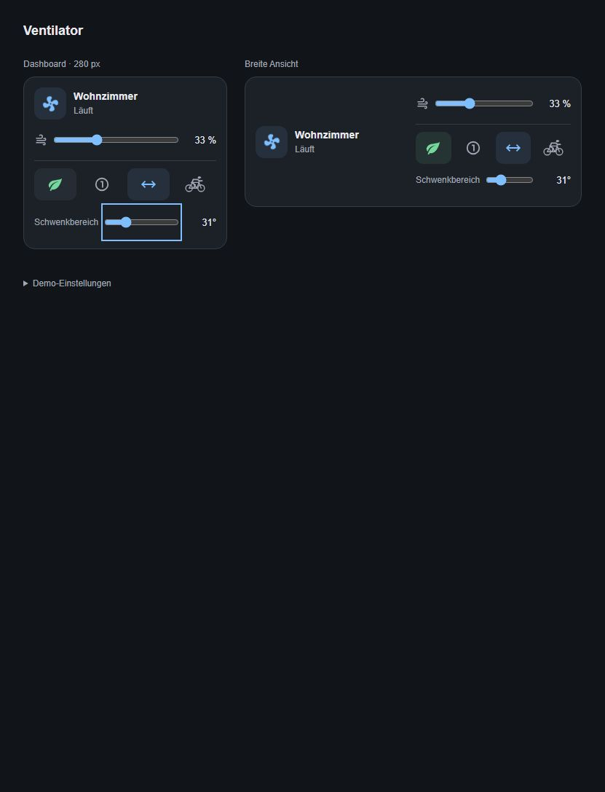

# Smart Fan 2 Card

Home-Assistant-Dashboard-Karte für Smartmi Standing Fan 2S / Smart Fan 2 und andere `fan.*`-Entitäten. Der visuelle Editor bietet alle Fan-Entitäten zur Auswahl an. Name und unterstützte Funktionen werden aus der ausgewählten Entität übernommen.

Aktuelle Version: **0.5.0**. Vereinfachter Editor mit automatischer Übernahme der Fan-Eigenschaften und optionalem Schwenkbereich-Slider.



## Funktionen

- Zwei Layouts: `compact` (schmal, Dashboard) und `wide` (breit, Web UI). Breit fällt auf kleinen Displays auf eine Spalte zurück.
- Fan-Symbol als Ein-/Ausschalter: dreht sich im Betrieb und steht ausgeschaltet still. Die Systemeinstellung „Bewegung reduzieren“ deaktiviert die Animation.
- Geschwindigkeitsregler, Oszillation und verfügbare Preset-Modi.
- Optionaler Schwenkbereich-Slider unter der Button-Reihe. Erkennt die zugehörige Winkel-Entität automatisch über dasselbe Gerät oder den passenden Entitätsnamen und übernimmt Min/Max/Schrittweite.
- Normal/Natural-Taste: blau für Normal, grün für Natural. Erkennt unter anderem `Straight Wind` / `Natural Wind`; abweichende Namen im Editor zuordnen.
- Stärke-Taste: schaltet zyklisch auf 33, 66 und 100 Prozent.
- Cycling-Taste mit Rennrad und Fahrer in Zeitfahrhaltung: deaktiviert zuerst Oszillation und führt anschließend eine konfigurierte Aktion für „ganz links“ aus. Beim laufenden Zielwinkel-Ablauf wird sie zur Stopptaste.
- Alternativer Cycling-Ablauf im Editor: maximalen Schwenkbereich einstellen, Oszillation starten und bei konfigurierbarem Zielwinkel stoppen. Benötigt eine getrennte Entität für die echte Kopfposition.
- Theme-Variablen, Tastaturbedienung, reduzierte Animation, Fehlermeldungen und Schutz gegen parallele Bedienbefehle.

## Installation mit HACS

Das Repository ist öffentlich und kann in HACS als benutzerdefiniertes Dashboard-Repository hinzugefügt werden. Alternativ ist eine manuelle Installation möglich.

Offizielle Anleitungen: [Allgemeine Anforderungen](https://hacs.xyz/docs/publish/start/), [Dashboard-Plugins](https://hacs.xyz/docs/publish/plugin/), [Custom Repositories](https://hacs.xyz/docs/faq/custom_repositories/), [Custom Cards](https://developers.home-assistant.io/docs/frontend/custom-ui/custom-card/).

### Manuelle Installation

1. `dist/smart-fan-2-card.js` nach `/config/www/smart-fan-2-card.js` kopieren.
2. Unter Einstellungen → Dashboards → Ressourcen die URL `/local/smart-fan-2-card.js?v=0.5.0` als **JavaScript-Modul** hinzufügen (erweiterter Modus ggf. aktivieren).
3. Browser vollständig neu laden, dann Dashboard bearbeiten → Karte hinzufügen → **Smart Fan 2 Card** → Fan-Entität und Layout auswählen.

Bei einem Update die Datei ersetzen und die bestehende Ressourcen-URL mit einem neuen `?v=…`-Wert aktualisieren, damit der Browser die neue Datei lädt. Keine zweite Ressource für dieselbe Karte anlegen. Ein Home-Assistant-Neustart ist dafür nicht erforderlich.

### HACS Custom Repository

[](https://my.home-assistant.io/redirect/hacs_repository/?owner=jancrab&repository=smart-fan-2-card&category=plugin)

Der Button öffnet das Repository in HACS deiner Home-Assistant-Instanz; dort bestätigst du das Hinzufügen und Herunterladen. HACS muss bereits installiert sein. Siehe [offizielle Anleitung zu My-Links](https://hacs.dev/docs/use/my/).

1. HACS → Menü ⋮ → Benutzerdefinierte Repositories.
2. `https://github.com/jancrab/smart-fan-2-card` eintragen und Typ **Dashboard** auswählen.
3. Karte herunterladen und Browser neu laden. Ressource prüfen: `/hacsfiles/smart-fan-2-card/smart-fan-2-card.js`, Typ JavaScript-Modul. Bei YAML-verwalteten Ressourcen selbst eintragen.
4. Die Karte im Dashboard hinzufügen. Keine Aufnahme in den HACS-Standardkatalog erforderlich.

## Konfiguration

Im visuellen Editor reichen **Ventilator** und **Layout**. Name, Funktionen und Modi kommen aus der Fan-Entität. Unter **Darstellung (optional)** können Name/Untertitel überschrieben und der Schwenkbereich-Slider aktiviert werden. Cycling liegt in einem getrennten optionalen Bereich; dort werden nur die Felder des ausgewählten Ablaufs angezeigt. Manuelle Moduszuordnung erscheint nur, wenn die Presets nicht automatisch erkannt werden.

```yaml
type: custom:smart-fan-2-card
entity: fan.dein_ventilator
layout: compact # alternativ: wide
```

Der Anzeigename kommt aus `friendly_name`. Optional sind `name` und `subtitle` überschreibbar. Zusätzliche Zuordnungen:

Schwenkbereich-Slider aktivieren:

```yaml
show_angle_slider: true
# Optional, falls keine eindeutige automatische Zuordnung möglich ist:
angle_entity: number.smartmi_standing_fan_2s_oscillation_angle
```

Der Slider setzt den Schwenkbereich über `number.set_value`; er steuert keine absolute Kopfposition und schaltet Oszillation nicht automatisch ein. Ohne verfügbare Winkel-Entität zeigt die Karte einen Hinweis. Standardmäßig ist der Slider ausgeblendet.

```yaml
natural_preset: Natural Wind # exakt wie in preset_modes
normal_preset: Straight Wind
left_entity: script.ventilator_ganz_links
```

`left_entity` kann eine `button`-, `script`-, `number`- oder `select`-Entität sein. Bei `number` zusätzlich `left_value` mit dem vom Gerät erwarteten Zahlenwert angeben; bei `select` mit dem exakten Optionsnamen. Die Taste bleibt ohne verfügbare Aktion deaktiviert. Ein Links-Schritt ist keine absolute Endposition: nur eine Aktion zuordnen, die tatsächlich bis zum linken Anschlag fährt. Das Script darf keine Wartezeit vor dem Stoppen der Oszillation voraussetzen; nötige gerätespezifische Wartezeiten gehören ins Script.

`number.smartmi_standing_fan_2s_oscillation_angle` legt den Schwenkbereich fest und darf nicht mit einer absoluten Kopfposition verwechselt werden. Diese Entität wird deshalb nicht automatisch als Links-Aktion zugeordnet.

### Cycling mit Zielwinkel

Im visuellen Editor **Cycling: Ablauf → Maximal schwenken → am Zielwinkel stoppen** wählen. Dort sind Schwenkbereich-Entität, Positionsrückmeldung, Zielwinkel, optionaler Maximalwinkel, Toleranz und Zeitlimit einstellbar. Beispiel mit einer hypothetischen Positionsentität:

```yaml
cycling_mode: position
angle_entity: number.smartmi_standing_fan_2s_oscillation_angle
position_entity: sensor.dein_ventilator_kopfposition # muss wirklich existieren und die Bewegung melden
target_angle: -60
target_tolerance: 2
cycling_timeout: 30
# cycling_max_angle: 120 # ohne Angabe: max-Attribut der angle_entity
```

Schwenkbereich und Position dürfen nicht dieselbe Entität sein. Ein erneut gedrückter Cycling-Button bricht den Ablauf ab und sendet einen Stop-Befehl. Fehlende Rückmeldung, Zeitlimit oder das Entfernen der Karte stoppen ebenfalls den Ablauf. Der eingestellte Schwenkbereich bleibt erhalten. Die Stop-Genauigkeit hängt von Aktualisierungsintervall und Befehlslatenz ab; beim Überspringen des Zielwinkels wird nachträglich gestoppt.

Die Steuerung läuft im Browser: Ein vollständiger Browserabsturz, geschlossenes Fenster oder Netzwerkverlust kann den Stop-Befehl verhindern. Für einen vom geöffneten Dashboard unabhängigen Ablauf ein serverseitiges Home-Assistant-Script als Links-Aktion verwenden. Ob dein Gerät eine echte Positionsrückmeldung anbietet, muss am Gerät geprüft werden. [Analyse der Referenzkarte](docs/reference-features.md).

Natural erkennt auch die Xiaomi-Presets `nature` und `normal`. Veraltete manuelle Zuordnungen werden ignoriert, wenn sie nicht in den aktuellen Presets vorkommen. Ohne eindeutiges Moduspaar bleibt Natural deaktiviert. Die Karte steuert über die normale Fan-API, nicht direkt über Xiaomi-Cloud-Zugangsdaten. Zusätzliche Gerätefunktionen können je nach Xiaomi-Home-Modell als separate Entitäten vorliegen. Ein Test am realen Gerät steht aus.

## Entwicklung

```sh
npm ci
npm run check
npm run dev
```

Vorschauen bei laufendem Dev-Server:

- Hell: <http://127.0.0.1:4173> (`demo/index.html`).
- Dunkel: <http://127.0.0.1:4173/demo/dark.html> (`demo/dark.html`).

Beide zeigen die echte gebaute Karte mit simulierten Geräten und senden keine Gerätebefehle. Die Dark-Mode-Vorschau setzt Home-Assistant-Theme-Variablen. Nach Änderungen zuerst `npm run build` ausführen. `dist/` wird mit versioniert, sodass HACS die einzelne gebündelte Datei direkt findet. Keine CDN-Abhängigkeiten zur Laufzeit.

CI prüft Tests, Build und Übereinstimmung von Quellcode/Distribution. Die HACS-Validierung läuft für das öffentliche Repository zusätzlich. Ein Tag `v<package.json-Version>` baut und testet erneut und erstellt ein GitHub-Release mit JavaScript-Asset. Vor dem nächsten Release Paketversion, Lockdatei und Changelog aktualisieren, neu bauen und einen neuen Tag verwenden. Aktueller Teststand: Build und alle 20 Tests erfolgreich; ein Test am echten Gerät steht aus.

## Gestaltung

Kompakte Home-Assistant-Gerätekarte mit Gerätename, Zustand, Geschwindigkeitsregler und einer Reihe aus vier Icon-Tasten: Normal/Natural, Stärke, Schwenken, Cycling. Das Fan-Symbol schaltet direkt ein/aus und rotiert im Betrieb; ein separater Power-Button entfällt. Die schmale Vorschau ist 280 px breit, die breite Ansicht nutzt zwei Spalten und passt sich per Container Query an ihren tatsächlichen Platz an. Alle Tasten haben mindestens 44 × 44 px Bedienfläche, zugängliche Namen, Tooltips und sichtbaren Tastaturfokus. Ein zusätzliches Modusmenü erscheint nur bei weiteren Presets. Der Gerätename öffnet die Details.

Die Karte verwendet `ha-card` und `ha-icon` sowie eigene HTML-Bedienelemente. Hintergrund, Flächen, Text, Akzent, Rahmen, Radius und Schatten übernehmen Home-Assistant-Theme-Variablen und reagieren auf Theme-Wechsel. Normal und Natural haben eigene blaue beziehungsweise grüne Standardfarben, die im Theme überschrieben werden können. Die Demo definiert hierfür hellere Dark-Mode-Farben; das ist keine automatische Änderung der Standardfarben in Home Assistant.

Anpassbar per CSS: `--smart-fan-accent`, `--smart-fan-normal-color`, `--smart-fan-natural-color`. In einem Home-Assistant-Theme können die Variablen so gesetzt werden:

```yaml
smart-fan-accent: "#80bfff"
smart-fan-normal-color: "#80bfff"
smart-fan-natural-color: "#75d79b"
```

Die lokale Demo verwendet Material Design Icons, siehe [Icon-Lizenz](docs/MDI-LICENSE). Die installierte Karte verwendet Home Assistants `ha-icon`; das Zeitfahrrad ist ein eingebettetes SVG. Es wird keine zusätzliche Icon-Bibliothek geladen.

## Lizenz

MIT, siehe [LICENSE](LICENSE).
