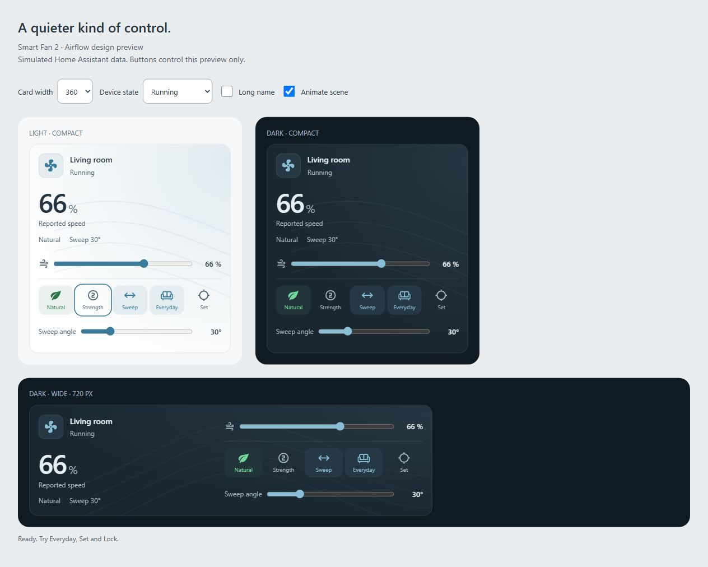

# Smart Fan 2 Card

A Home Assistant dashboard card for Smartmi Standing Fan 2S / Smart Fan 2 and compatible `fan.*` entities. Select a fan and a layout; the card reads its name, supported controls and modes automatically.

Current version: **0.10.0**.



[Design notes and appearance settings](docs/design-style.md). The screenshot shows the card with simulated data.

## Features

- Compact dashboard and wide web layouts, responsive to the available space.
- Click the fan icon to turn power on or off. A quiet airflow scene follows the reported speed and respects reduced motion.
- Speed slider and strength levels at 33 / 66 / 100%.
- Normal (blue) / Natural (green) toggle, using the exact presets exposed by your integration, including `normal` / `nature`.
- Oscillation toggle and optional sweep angle slider. The slider appears while oscillation is active.
- Everyday profile: Natural, 66%, oscillation at 30° by default.
- Cycling **Set / Lock**: manually stop the head at your preferred position with a configurable speed and mode.
- Home Assistant theme variables, keyboard focus, accessible labels and service error feedback.

## Install through HACS

[](https://my.home-assistant.io/redirect/hacs_repository/?owner=jancrab&repository=smart-fan-2-card&category=plugin)

HACS must already be installed. The button opens the repository in your Home Assistant instance, where you confirm adding and downloading it.

Alternatively, open HACS → menu → Custom repositories, add `https://github.com/jancrab/smart-fan-2-card` as a **Dashboard** repository, then download the card. Check that `/hacsfiles/smart-fan-2-card/smart-fan-2-card.js` is registered as a JavaScript module. Reload the browser and add **Smart Fan 2 Card** to your dashboard.

See the [HACS custom repository guide](https://hacs.dev/docs/faq/custom_repositories/) and [My Home Assistant link guide](https://hacs.dev/docs/use/my/).

### Manual installation

1. Copy `dist/smart-fan-2-card.js` to `/config/www/smart-fan-2-card.js`.
2. Under Settings → Dashboards → Resources, add `/local/smart-fan-2-card.js?v=0.10.0` as a **JavaScript module**. Enable advanced mode if needed.
3. Reload the browser and add the card.

For updates, replace the file and change the version query on the existing resource. Do not add duplicate resources. A Home Assistant restart is not required.

## Configuration

The visual editor starts with **Fan** and **Layout**. Optional sections cover appearance, Everyday and Cycling profiles. Manual preset mapping appears when the fan modes cannot be recognized automatically.

```yaml
type: custom:smart-fan-2-card
entity: fan.smartmi_standing_fan_2s
layout: compact # or wide
show_angle_slider: true
# Optional override if automatic discovery is ambiguous:
# angle_entity: number.smartmi_standing_fan_2s_oscillation_angle

everyday_preset: nature # or normal
everyday_percentage: 66
everyday_angle: 30 # degrees
cycling_preset: nature # or normal
cycling_percentage: 100
```

Optional `name` and `subtitle` override the heading. `natural_preset` and `normal_preset` can map unusual integration preset names. Invalid old mappings are ignored when absent from the fan's presets.

### Cycling: Set / Lock

1. Configure **Locked mode** and **Locked speed** under **Cycling · Set / Lock**. Defaults are Natural and 100%.
2. Press **Set**. The card turns the fan on if needed, applies the profile, sets the sweep angle entity to its reported maximum (120° for the supplied Smartmi entity), then starts oscillation.
3. Watch the physical head. Press **Lock** at your preferred position. The card sends the stop command first, then reapplies the configured mode and speed.
4. Speed and mode controls in this card are locked while the reported state matches the locked profile. Use Set to reposition, Everyday to restore the everyday profile, toggle oscillation, or turn the fan off to exit the lock.

No positioning script, administrator permission or live position sensor is required. A sweep angle entity is needed to start maximum sweep; it is auto-detected from the same device or the matching fan entity name. You can override it in the editor. Lock remains available during positioning even if the angle entity becomes unavailable.

This is manual positioning: the card cannot measure or guarantee an absolute head angle. The stop has network/device latency. The lock applies to this card's controls, and clears on page reload; other cards and automations can change the fan. Closing the page while sweeping leaves oscillation running until you stop it through Home Assistant.

Older `cycling_mode`, `position_entity`, `target_angle`, `target_tolerance`, `cycling_timeout`, `cycling_max_angle`, `left_entity` and `left_value` fields are ignored in 0.8.0 and can be removed from YAML. The former positioning script generator and blueprint have been removed from the current version; scripts already saved in Home Assistant remain there but are no longer called by the card. [Migration details](docs/cycling-script.md).

### Sweep angle and head position

`number.smartmi_standing_fan_2s_oscillation_angle` configures the sweep width. It does not report the live head position. None of the entities supplied for this device expose a live position sensor. The reference card's hardcoded 30/60/90/120° values are sweep presets. [Reference analysis](docs/reference-features.md).

The angle slider inherits the entity's min/max/step and calls `number.set_value`. It does not turn oscillation on automatically. Everyday restores its configured sweep width after Cycling.

## iOS Home Screen widget

Use the official Home Assistant app's Custom Widget with server-side scripts for
**Power, Everyday, Set, Lock, Strength and Natural / Normal**. The shared controller
keeps widget profiles in one place; separate Set and Lock buttons avoid relying
on iOS state refresh timing. No position sensor or separate iOS app is needed.

[Import blueprints and follow the iPhone setup guide](docs/ios-widget.md).
The widget requires a one-time setup in the Companion app. HACS installs the
frontend card; it does not install these scripts or add the iPhone widget.

## Themes and accessibility

The card uses `ha-card`, `ha-icon` and Home Assistant CSS theme variables for background, text, borders, radius and shadows. Normal and Natural colors can be overridden in your theme:

```yaml
smart-fan-accent: "#80bfff"
smart-fan-normal-color: "#80bfff"
smart-fan-natural-color: "#75d79b"
```

Controls have at least 44 × 44 px touch targets, accessible names and visible keyboard focus. Airflow pauses outside the viewport, in hidden tabs and with reduced motion. The power icon stays still so airflow is the only continuous animation. All card and editor labels are English; device names and integration presets retain their original values.

Appearance settings in the visual editor are optional and preserve existing YAML:

```yaml
show_scene: true
animate_scene: true
show_summary: true
show_angle_slider: false
```

The first three default to true. The existing sweep slider remains opt-in.
`smart-fan-scene-light` / `smart-fan-scene-dark` override the scene tint;
`smart-fan-flow-light` / `smart-fan-flow-dark` override the line color. Defaults
blend the HA card surface with the theme accent. HA's active dark-mode flag selects
the palette; fonts, text, radius and shadows remain theme-native.

## Development

For future cards and new chats, start with [AGENTS.md](AGENTS.md) and the
[reusable custom-card workflow](docs/custom-card-workflow.md). They preserve the
HACS, editor, device-control, testing and GitHub release lessons from this project.

The reusable [ha-card-init skill](skills/ha-card-init/SKILL.md) scaffolds independent
card repositories with their own AGENTS.md, editor, tests and release workflows.
Its generator refuses existing nonempty folders and leaves remote publication to
the authorized task. Install the skill folder into your Codex skills directory.

```sh
npm ci
npm run check
npm run dev
```

Blueprint tests (Python 3):

```sh
python -m pip install -r requirements-test.txt
python -m unittest discover -s test -p "test_*.py"
```

Open the [interactive Light / Dark design preview](http://127.0.0.1:4173/demo/airflow.html) to test 280 / 360 / 480 px widths, long names, missing data and service errors. Or open the [light preview](http://127.0.0.1:4173/) or [dark preview](http://127.0.0.1:4173/demo/dark.html). Both load the real built card with simulated devices and send no commands to Home Assistant. Rebuild after editing source files. The demo uses [Material Design Icons](docs/MDI-LICENSE); the installed card uses Home Assistant's icon components.

CI runs tests, builds the bundle and checks that the committed distribution matches the source. HACS validation runs for the public repository. A `v<package.json version>` tag builds, tests and creates a release with the JavaScript asset. Runtime dependencies are bundled; no CDN is required.

Service sequences, failure paths, state rendering, editor loading and Set / Lock are tested with mocked Home Assistant. Physical movement and integration latency still require a real-device test.

## License

MIT. See [LICENSE](LICENSE).
