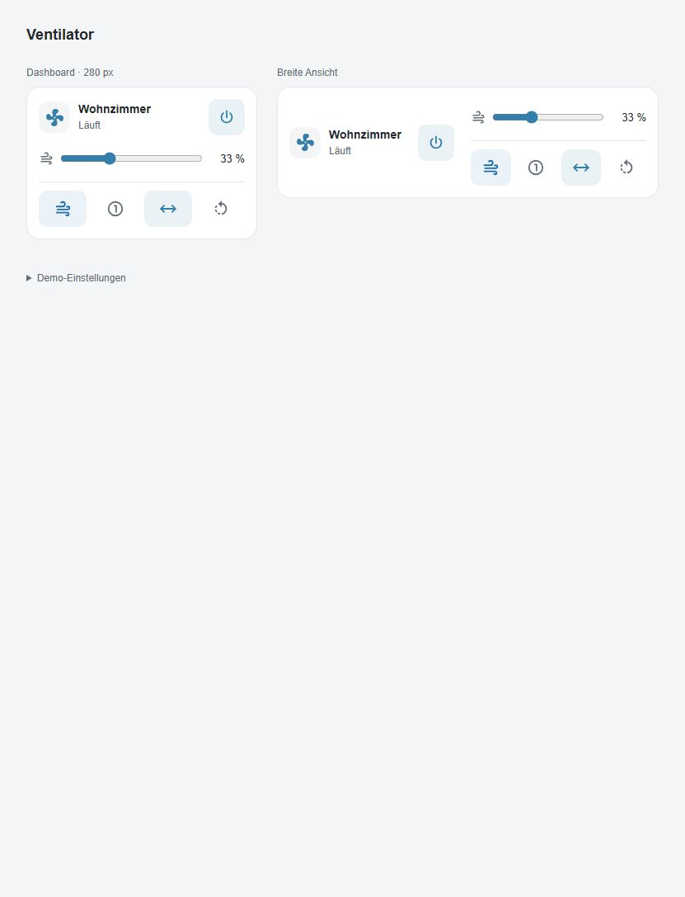

# Smart Fan 2 Card

Home-Assistant-Dashboard-Karte für Smartmi Standing Fan 2S / Smart Fan 2 und andere `fan.*`-Entitäten. Der visuelle Editor bietet alle Fan-Entitäten zur Auswahl an. Name und unterstützte Funktionen werden aus der ausgewählten Entität übernommen.



## Funktionen

- Zwei Layouts: `compact` (schmal, Dashboard) und `wide` (breit, Web UI). Breit fällt auf kleinen Displays auf eine Spalte zurück.
- Ein/Aus, Geschwindigkeitsregler, Oszillation und verfügbare Preset-Modi.
- Normal/Natural-Taste: blau für Normal, grün für Natural. Erkennt unter anderem `Straight Wind` / `Natural Wind`; abweichende Namen im Editor zuordnen.
- Stärke-Taste: schaltet zyklisch auf 33, 66 und 100 Prozent.
- Cycling-Taste: deaktiviert zuerst Oszillation und führt anschließend eine konfigurierte Aktion für „ganz links“ aus.
- Alternativer Cycling-Ablauf im Editor: maximalen Schwenkbereich einstellen, Oszillation starten und bei konfigurierbarem Zielwinkel stoppen. Benötigt eine getrennte Entität für die echte Kopfposition.
- Theme-Variablen, Tastaturbedienung, reduzierte Animation, Fehlermeldungen und Schutz gegen parallele Bedienbefehle.

## Privat und HACS

**HACS unterstützt ausschließlich öffentliche GitHub-Repositories – auch als Custom Repository.** Dieses Projekt wird zunächst privat entwickelt. Struktur, Manifest und JavaScript-Datei sind für eine spätere HACS-Verteilung vorbereitet; privat wird manuell installiert.

Offizielle Anleitungen: [Allgemeine Anforderungen](https://hacs.xyz/docs/publish/start/), [Dashboard-Plugins](https://hacs.xyz/docs/publish/plugin/), [Custom Repositories](https://hacs.xyz/docs/faq/custom_repositories/), [Custom Cards](https://developers.home-assistant.io/docs/frontend/custom-ui/custom-card/).

### Manuelle Installation (privates Repo)

1. `dist/smart-fan-2-card.js` nach `/config/www/smart-fan-2-card.js` kopieren.
2. Unter Einstellungen → Dashboards → Ressourcen die URL `/local/smart-fan-2-card.js?v=0.1.0` als **JavaScript-Modul** hinzufügen (erweiterter Modus ggf. aktivieren).
3. Dashboard bearbeiten → Karte hinzufügen → **Smart Fan 2 Card** → Fan-Entität und Layout auswählen.

### HACS Custom Repository (erst nach öffentlicher Freigabe)

1. HACS → Menü ⋮ → Benutzerdefinierte Repositories.
2. Repository-URL eintragen und Typ **Dashboard** auswählen.
3. Karte herunterladen und Browser neu laden. Ressource prüfen: `/hacsfiles/smart-fan-2-card/smart-fan-2-card.js`, Typ JavaScript-Modul. Bei YAML-verwalteten Ressourcen selbst eintragen.
4. Die Karte im Dashboard hinzufügen. Keine Aufnahme in den HACS-Standardkatalog erforderlich.

## Konfiguration

```yaml
type: custom:smart-fan-2-card
entity: fan.dein_ventilator
layout: compact # alternativ: wide
```

Der Anzeigename kommt aus `friendly_name`. Optional sind `name` und `subtitle` überschreibbar. Zusätzliche Zuordnungen:

```yaml
natural_preset: Natural Wind # exakt wie in preset_modes
normal_preset: Straight Wind
left_entity: script.ventilator_ganz_links
```

`left_entity` kann eine `button`-, `script`-, `number`- oder `select`-Entität sein. Bei `number` zusätzlich `left_value` mit dem vom Gerät erwarteten Zahlenwert angeben; bei `select` mit dem exakten Optionsnamen. Die Taste bleibt ohne verfügbare Aktion deaktiviert. Ein Links-Schritt ist keine absolute Endposition: nur eine Aktion zuordnen, die tatsächlich bis zum linken Anschlag fährt. Das Script darf keine Wartezeit vor dem Stoppen der Oszillation voraussetzen; nötige gerätespezifische Wartezeiten gehören ins Script.

`number.smartmi_standing_fan_2s_oscillation_angle` legt den Schwenkbereich fest und darf nicht mit einer absoluten Kopfposition verwechselt werden. Diese Entität wird deshalb nicht automatisch als Links-Aktion zugeordnet.

### Cycling mit Zielwinkel

Im visuellen Editor **Cycling: Ablauf → Maximal schwenken → am Zielwinkel stoppen** wählen. Dort sind Schwenkbereich-Entität, Positionsrückmeldung, Zielwinkel, optionaler Maximalwinkel, Toleranz und Zeitlimit einstellbar. Beispiel mit einer hypothetischen Positionsentität:

```yaml
cycling_mode: position
angle_entity: number.smartmi_standing_fan_2s_oscillation_angle
position_entity: sensor.dein_ventilator_kopfposition # muss wirklich existieren und die Bewegung melden
target_angle: -60
target_tolerance: 2
cycling_timeout: 30
# cycling_max_angle: 120 # ohne Angabe: max-Attribut der angle_entity
```

Schwenkbereich und Position dürfen nicht dieselbe Entität sein. Ein erneut gedrückter Cycling-Button bricht den Ablauf ab und sendet einen Stop-Befehl. Fehlende Rückmeldung, Zeitlimit oder das Entfernen der Karte stoppen ebenfalls den Ablauf. Der eingestellte Schwenkbereich bleibt erhalten. Die Stop-Genauigkeit hängt von Aktualisierungsintervall und Befehlslatenz ab; beim Überspringen des Zielwinkels wird nachträglich gestoppt.

Die Steuerung läuft im Browser: Ein vollständiger Browserabsturz, geschlossenes Fenster oder Netzwerkverlust kann den Stop-Befehl verhindern. Für einen vom geöffneten Dashboard unabhängigen Ablauf ein serverseitiges Home-Assistant-Script als Links-Aktion verwenden. Ob dein Gerät eine echte Positionsrückmeldung anbietet, muss am Gerät geprüft werden. [Analyse der Referenzkarte](docs/reference-features.md).

Natural bleibt ohne eindeutiges Moduspaar deaktiviert. Die Karte steuert über die normale Fan-API, nicht direkt über Xiaomi-Cloud-Zugangsdaten. Zusätzliche Gerätefunktionen können je nach Xiaomi-Home-Modell als separate Entitäten vorliegen. Ein Test am realen Gerät steht aus.

## Entwicklung

```sh
npm ci
npm run check
npm run dev
```

Demo: <http://127.0.0.1:4173>. Sie simuliert Home Assistant lokal und sendet keine Gerätebefehle. Nach Änderungen zuerst `npm run build` ausführen. `dist/` wird mit versioniert, sodass HACS die einzelne gebündelte Datei direkt findet. Keine CDN-Abhängigkeiten zur Laufzeit.

CI prüft Tests, Build und Übereinstimmung von Quellcode/Distribution. Die HACS-Validierung läuft nach öffentlicher Freigabe. Ein Tag `v<package.json-Version>` baut und testet erneut und erstellt ein GitHub-Release mit JavaScript-Asset. Für die erste Version: `git tag v0.1.0` und `git push origin v0.1.0`.

## Gestaltung

Kompakte Home-Assistant-Gerätekarte mit Gerätename, Zustand, Geschwindigkeitsregler und einer Reihe aus vier Icon-Tasten: Normal/Natural, Stärke, Schwenken, Cycling. Keine dekorative Lüfteranimation. Die schmale Vorschau ist 280 px breit, die breite Ansicht nutzt zwei Spalten und passt sich per Container Query an ihren tatsächlichen Platz an. Geräteschrift und Farben folgen dem HA-Theme. Alle Tasten haben mindestens 44 × 44 px Bedienfläche, zugängliche Namen, Tooltips und sichtbaren Tastaturfokus. Ein zusätzliches Modusmenü erscheint nur bei weiteren Presets. Der Gerätename öffnet die Details.

Anpassbar per CSS: `--smart-fan-accent`, `--smart-fan-normal-color`, `--smart-fan-natural-color`. Die lokale Demo verwendet Material Design Icons, siehe [Icon-Lizenz](docs/MDI-LICENSE). Die installierte Karte verwendet Home Assistants `ha-icon` und lädt keine zusätzliche Icon-Bibliothek.

## Lizenz

MIT, siehe [LICENSE](LICENSE).
