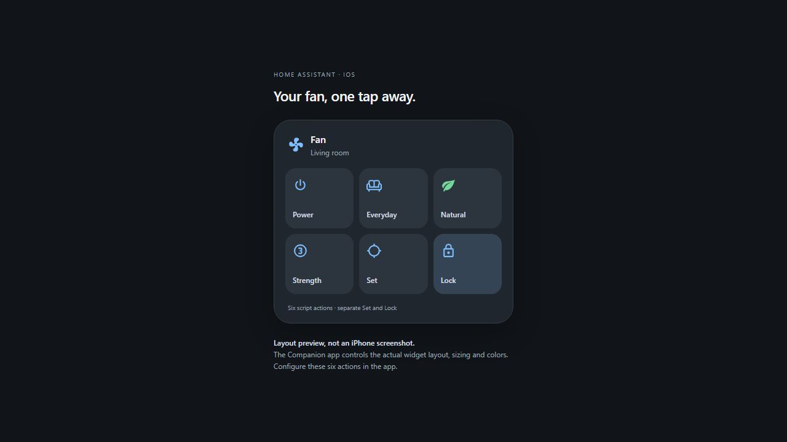

# iOS widget using the Home Assistant app

Use the official Home Assistant Companion app's **Custom Widget**. There is no
separate iOS app, Apple developer account, TestFlight build or dashboard card to
install. Home Assistant runs the actions on the server.

This is an HTML layout illustration, not a screenshot of an installed iPhone
widget. The Companion app controls the actual tile arrangement, sizing and colors.
Preview it locally at `/demo/ios-widget.html` while the development server is running.

## 1. Import the two script blueprints

Alternatively, under **Settings → Automations & scenes → Blueprints → Import**,
paste each blueprint's GitHub URL. Importing saves a template; it does not move
the fan or automatically create the scripts.

## 2. Create the controller and button scripts

Create one script from **Smart Fan - Widget controller**, named
**Smart Fan - Widget controller**. Select your fan and its sweep angle number:

- Fan: `fan.smartmi_standing_fan_2s`
- Sweep: `number.smartmi_standing_fan_2s_oscillation_angle`
- Everyday: Natural, 66%, 30° by default.
- Cycling: Natural, 100% by default.
- Exact preset names: `nature` and `normal` for this Smartmi. Other integrations
  may use different names; match their `preset_modes` exactly.

All widget profile settings are centralized here. They are independent of the
dashboard card configuration; set the same values in both if you want them to match.

Create six scripts from **Smart Fan - Widget button**. Select the same controller
script in each, then choose its button action:

| Script name | Button action | Suggested icon | Behavior |
| --- | --- | --- | --- |
| Fan - Power | Power | `mdi:power` | Toggle power |
| Fan - Everyday | Everyday | `mdi:sofa-outline` | Apply Everyday profile and start its sweep |
| Fan - Set | Set | `mdi:crosshairs` | Apply Cycling profile and start maximum sweep |
| Fan - Lock | Lock | `mdi:lock-outline` | Stop immediately, then apply Cycling mode/speed |
| Fan - Strength | Strength | `mdi:numeric-3-circle-outline` | Cycle 33 → 66 → 100 → 33% |
| Fan - Natural | Natural / Normal | `mdi:leaf` | Toggle the actual preset |

For YAML-managed scripts, [the complete example](../examples/ios-widget-scripts.yaml)
creates the controller and all six buttons after importing the blueprints. Add its
entries to your existing `scripts.yaml`, adjust entities and blueprint paths, check
configuration, then reload scripts. Preserve existing entries and use unique IDs.
The example references `script.smart_fan_widget_controller`; change all button
references if your controller has a different entity ID.

The shared controller uses restart mode: Lock interrupts an unfinished Set sequence
instead of letting that sequence start oscillation later. Each button uses
`script.turn_on`, so a button script finishing only confirms dispatch. Inspect the
**controller's trace** for actual execution errors. Already dispatched device
commands and network latency can still affect stopping.

## 3. Build the widget on your iPhone

1. Open the Home Assistant app and sign in to the same server.
2. Open **Settings → Companion app → Widgets → Create**.
3. Create a Custom Widget named **Fan**.
4. Add the button scripts above. Give each a short English label and an icon.
   Set **On tap → Run script**, selecting the matching script. If the editor
   offers separate icon and tile tap actions, configure both consistently.
5. Keep confirmation disabled for **Lock**, so stopping does not require a
   second tap. Choose confirmation for other buttons according to your preference.
6. Long-press the iPhone Home Screen → add widget → Home Assistant →
   **Custom Widget**. Choose a medium or large size for the six controls.
7. Edit the placed widget and select **Fan**. Use **Show last update time** if
   you display device states.

The exact menu wording may vary with the app version. A smaller widget can expose
just Power, Everyday, Set and Lock. The simpler **Scripts** widget is also an option
if you do not need custom tile styling.

## What Lock means here

Set and Lock are separate buttons because iOS does not guarantee real-time widget
state updates. Lock stops at the head's current physical position; it does not
measure or remember an absolute angle. No position sensor is required.

Lock applies the Cycling profile once. It does not enforce a global speed/mode
lock, create an input boolean, or activate the dashboard card's local UI lock.
Other controls and automations can still change the fan.

The server does not require an open dashboard or an iPhone screen to finish a
script. However, Set leaves oscillation running until you send Lock or another stop
command. The phone must be able to reach Home Assistant to send that command.
This setup does not create remote access; use your existing Companion app connection.

## Test on the real fan

First run each button script from Home Assistant before adding the widget:

1. Everyday should report `preset_mode: nature`, `percentage: 66`,
   `oscillating: true` and sweep width 30°.
2. Set should select Natural/100%, maximum sweep width, and oscillation on.
3. Lock should stop motion and retain the configured Cycling mode/speed.
4. Test Natural in both directions and Strength across all three levels.
5. Repeat from the iPhone widget. Compare the actual fan and Home Assistant states,
   rather than relying solely on the widget's cached labels.

The repository tests render the shipped Jinja templates and exercise their command
sequences with mocked Home Assistant state. They do not replace a live Home Assistant
import, an iOS installation test or a physical fan test.

References: [Companion app iOS widgets](https://companion.home-assistant.io/docs/integrations/ios-widgets/),
[Home Assistant blueprint schema](https://www.home-assistant.io/docs/blueprint/schema/).
